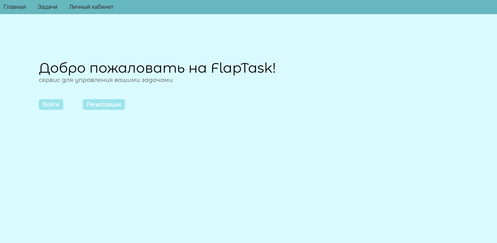
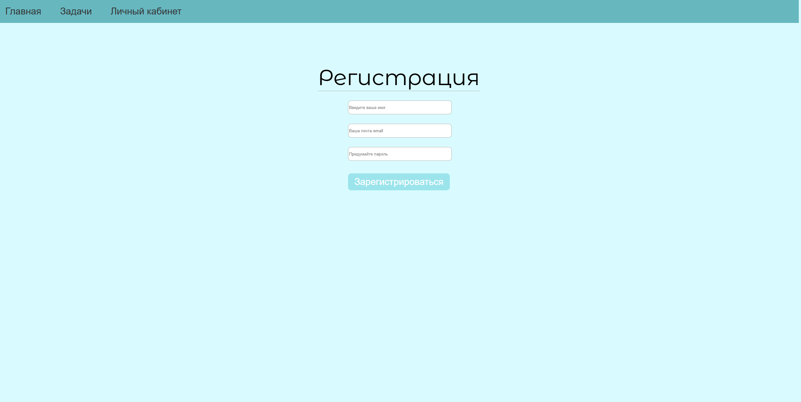
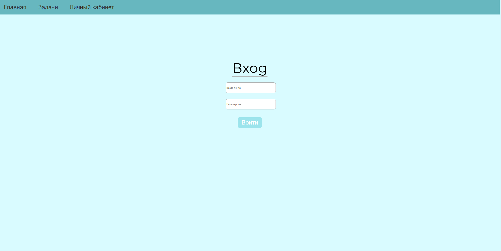
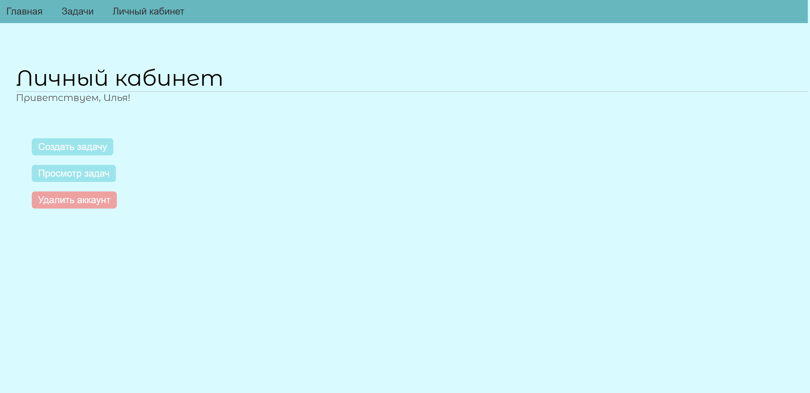
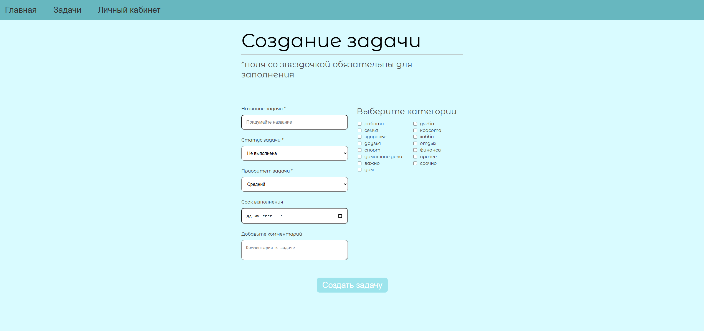
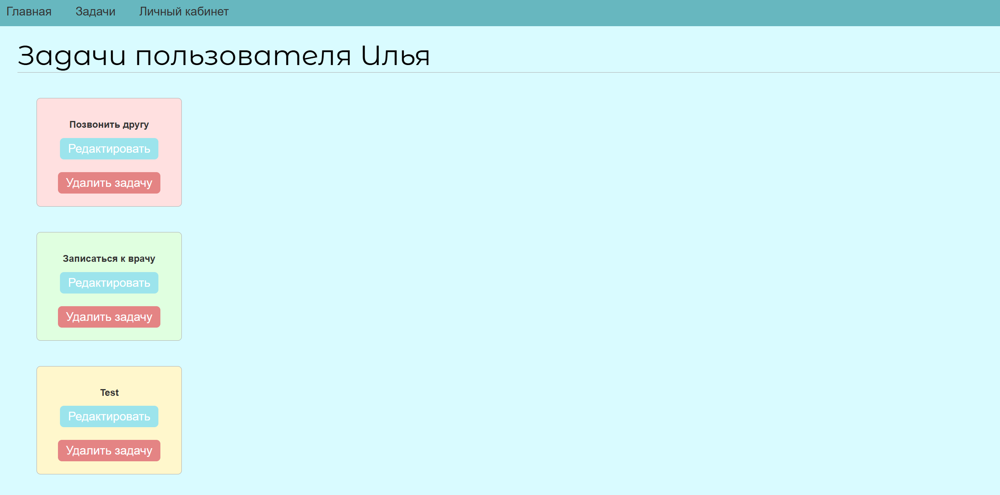
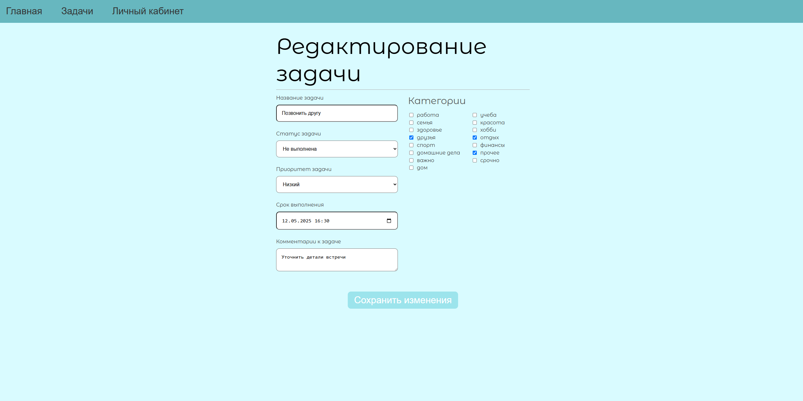
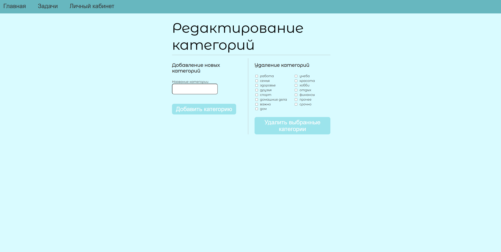

# Task Manager 'FlapTask'

**'FlapTask'** - это удобное и минималистичное веб-приложение на FastAPI, позволяющее пользователям эффективно управлять своими задачами: создавать, просматривать, редактировать и удалять. Все действия защищены авторизацией через токены и cookie.

Веб-приложение доступно по [ссылке](http://194.39.101.101:8000/)

Десктопное приложение можно скачать из директории dist -> *FlapTask.exe*

## Возможности

### Работа с пользователями
- Регистрация аккаунта (с хешированием пароля)
- Авторизация с использованием JWT-токенов (в куки)
- Удаление аккаунта

### Управление задачами
- Создание задач:
    - Название, статус, приоритет, дедлайн, комментарии
    - Привязка категорий
- Просмотр задач пользователя
- Редактирование и удаление задач (с каскадным удалением)

### Работа с категориями
- Создание/удаление категорий (доступно только `is_admin`)
- Привязка категорий к задачам

### Web-интерфейс
- Приветственная страница
- Регистрация и вход с использованием cookie
- Личный кабинет и просмотр задач
- Создание, редактирование и удаление задач
- Уведомления об успешных действиях

## Стек технологий

- **Backend:** FastAPI, SQLAlchemy, Jinja2
- **Frontend:** HTML + CSS (без JavaScript)
- **Database:** PostgreSQL
- **Хэширование паролей:** `passlib`
- **Работа с куки:** авторизация через cookie (без OAuth)

# Локальный запуск проекта

- Клонируйте репозиторий ```git clone https://github.com/MaryKhm656/task-manager```
- Создайте виртуальное окружение и активируйте его:
```commandline
python -m venv venv
```
```
venv\Scripts\activate
```
- Установите зависимости:
```commandline
pip install -r requirements.txt
```
- Запустите файл **generate_secret.py** для генерации секретного ключа и создания .env файла:
```commandline
python generate_secret.py
```
- После генерации секретного ключа, откройте .env файл и добавьте ваши данные для подключения к базе данных, по примеру из .env.example
```commandline
DATABASE_URL=postgresql://<имя пользователя>:<пароль>@<хост>:<порт>/<название базы данных>
```
- Запустите файл **init_database.py** для создания таблиц и связей в вашей базе данных
```commandline
python init_database.py
```
- После успешной инициализации, запустите файл main.py и перейдите по предложенной ссылке
```commandline
python main.py
```

## Скриншоты

### Приветственная страница


### Форма регистрации


### Вход


### Личный кабинет


### Создание задачи


### Просмотр задач


### Редактирование задачи


### Редактирование категорий(только `is_admin`)


## Автор
Разработано с ❤️ начинающим Python-разработчиком  
**Мария Хмельницкая**  
🔗 [GitHub: MaryKhm656](https://github.com/MaryKhm656)  
📧 nanoman66656@gmail.com